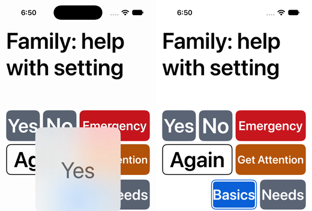
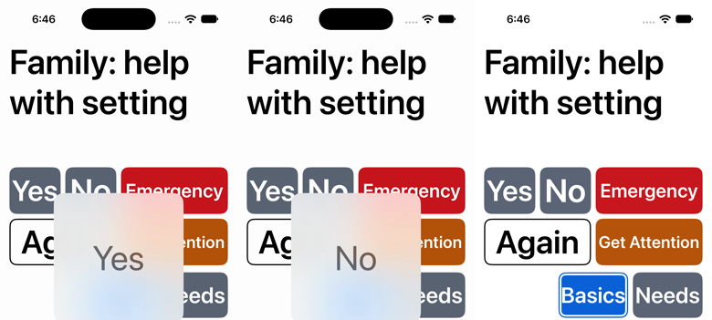
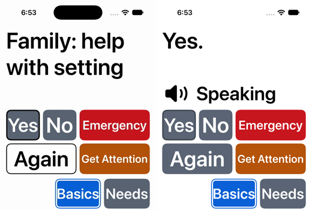
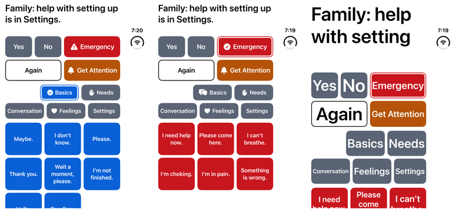
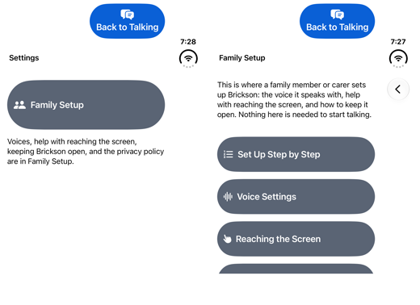

# The Large Content Viewer measured, and Brickson on the iPhone Duo simulator

*2026-10-23. Pull request #43 (`claude/project-thread-m1qa35`). The
"Large Content Viewer and iPhone Duo checks" thread, run on the owner's
Mac with Xcode 27.1 (27A9275) on macOS 27.0.1.*

## What changed and why

Two simulator checks that earlier pull requests left for a Mac.

**1. The Large Content Viewer stays off Home's controls, measured.**
PR #35 built SwiftUI's large content viewer
(`accessibilityShowsLargeContentViewer`) onto Home's buttons and held it
back: for UIKit's own controls Apple documents that, with the viewer, a
touch held on one control and slid onto another activates the second when
the finger lifts, so on Home a touch begun on Yes might say "No."
(docs/DECISIONS.md, "Show Borders and the Large Content Viewer on Home").
This pull request ran that check on simulators, on the shipped build and
on a test build with the viewer on Yes, No and every phrase tile.

SwiftUI's buttons did not do what UIKit documents. With the viewer, the
large copy showed and followed the finger from Yes onto No, and lifting
activated **nothing**: not No, but not Yes either. Worse, **a press on
Yes of 0.2 seconds or longer said nothing**, lifted in place or after a
slide, and so did a half-second press on No and on a phrase tile: the
kind of press a weak or unsteady hand makes. Only a 0.1-second tap still
spoke. That breaks invariant 2 (every phrase speaks on the first
activation, by any input method) for the people the viewer is for: those
who use an accessibility text size. Without the viewer, every press from
0.1 to 1.5 seconds spoke, and a slide from Yes onto No said Yes or
nothing, never No.

So the decision is now measured: no viewer on Home's controls, except
Settings' gear, which keeps the one it has where it shows alone (PR
#33). On iPhone Duo's closed display with Bold Text on, where the gear
shows alone, a tap opened Settings, and a held press, lifted in place or
slid onto each control around it, opened and changed nothing. Settings
never speaks, so that costs a family member a quicker second tap. The
decision: docs/DECISIONS.md, "Show Borders and the Large Content Viewer
on Home".

Two new UI tests keep it so. **`SlowPressTests`** runs in every UI run
on both devices: at the largest text size a half-second press on Yes and
on a phrase tile speaks (it failed on both with the viewer), and a held
slide from Yes onto No never says "No.". **`HeldSlideProbeTests`** is
the opt-in probe behind the results below, kept so it can be run again
after each major Xcode, in case SwiftUI's viewer changes:

```sh
TEST_RUNNER_BRICKSON_SLIDE_PROBE=1 scripts/test.sh ui '-only-testing:BricksonUITests/HeldSlideProbeTests'
```

**2. Brickson on the iPhone Duo simulator.** PR #41 planned R0 item 13,
*Ready for iPhone Duo*, and its first follow-up was to run the app in
the iPhone Duo simulator. Only the closed pose could run: folding the
simulator is expected to need Xcode's Device Hub window, which this
thread was not allowed to drive, and no command-line way to fold it was
found. Closed,
Brickson runs on the outer display, and two things showed up. **The
starter phrases scroll there at the default text size** (invariant 11),
as on the small 375×667 phone; and Settings' standard Back button moves
into a column at the screen's trailing edge, under the status bar.
Nothing in the app changed for either: the layout is the layout engine's
work, and PR #41 keeps the fold work for later. The owner's two fold
decisions (a wider gap at the fold, an even column count on a display
that folds) apply only to the inner display, which did not run.

## The Large Content Viewer: how it was measured

- **Where:** "iPhone 17" and "iPad Pro 13-inch (M5)" simulators on iOS
  27.0 (created for this run; this Mac's iOS 27.1 runtime offers only
  iPhone Duo), portrait, light, English, the starter library, Bold Text
  off unless a row says otherwise. Text size AX5
  (`UICTContentSizeCategoryAccessibilityXXXL`), set for the simulator
  (`xcrun simctl ui <udid> content_size
  accessibility-extra-extra-extra-large`) and for the app
  (`launchedApp(textSize: .ax5)`). Settings' gear alone: the iPhone Duo
  simulator (iOS 27.1) on its outer display, with Bold Text on.
- **The gestures** are XCTest's synthesised touches:
  `press(forDuration:)` for a press lifted in place, and
  `press(forDuration:thenDragTo:withVelocity:thenHoldForDuration:)` for a
  hold, a slow slide (`.slow`) and a short hold at the end. A held slide
  holds 1.5 s first, so the large copy shows before the touch moves.
  Each gesture starts from a fresh launch.
- **What counts as "nothing":** after each gesture the probe waits up to
  3 s for any sentence Home can show (every phrase on screen, Yes, No),
  and checks the first-run hint a fresh launch shows until something is
  spoken. "Nothing" is no sentence and the hint still there. The first
  runs, from an earlier draft of the probe with one test per gesture,
  looked only for the two sentences of the controls where the touch
  began and ended; the screenshots attached after each gesture showed
  the hint in every "nothing" case, and the final probe, rerun on the
  iPhone on both builds, gave the same results.
- **The test build** (never committed, never to ship) added
  `.accessibilityShowsLargeContentViewer { Text(verbatim: …) }` after
  Yes's and No's `accessibilityInputLabels` and after the phrase tile's
  `accessibilityIdentifier("phraseTile")` in `HomeView.swift`, with the
  visible words.
- **Film:** `xcrun simctl io <udid> recordVideo` ran during the probes;
  the frames below come from those recordings and from the screenshots
  the probe attaches after each gesture.

### Results

Each gesture ran at least once per build and device (the 0.25 to 1.0 s
row is four presses; on the iPhone most ran twice, in the first draft of
the probe and the final one, and agreed), at AX5 unless the row says otherwise. "—" was not run.

| Gesture | Shipped, iPhone 17 | Shipped, iPad Pro 13 | Viewer build, iPhone 17 | Viewer build, iPad Pro 13 |
|---|---|---|---|---|
| Tap Yes | Yes. | Yes. | Yes. | Yes. |
| Press Yes 0.1 s | Yes. | Yes. | Yes. | Yes. |
| Press Yes 0.2 s | Yes. | Yes. | nothing | nothing |
| Press Yes 0.25, 0.5, 0.75 or 1.0 s | Yes. | Yes. | nothing | nothing |
| Hold Yes 1.5 s, lift in place | Yes. | Yes. | nothing | nothing |
| Press No 0.5 s | No. | — | nothing | — |
| Press a phrase tile 0.5 s | its phrase | — | nothing | — |
| Hold Yes 1.5 s, slide onto No, lift | Yes. | nothing | nothing | nothing |
| Touch Yes 0.1 s, slide onto No, lift | Yes. | nothing | nothing | nothing |
| Hold a tile, slide onto the next in its row | the first tile's phrase | nothing | nothing | nothing |
| Hold a tile, slide onto the one below | nothing | nothing | nothing | nothing |
| Press Yes 0.5 s at the **default** text size | Yes. | — | Yes. | Yes. |

Settings' gear alone, shipped build, iPhone Duo's outer display, Bold
Text on, AX5 (the gear 78pt wide):

| Gesture | Result |
|---|---|
| Tap the gear | Settings opened |
| Hold the gear 1.5 s, lift in place | nothing opened or changed |
| Hold, slide onto Feelings (beside), lift | nothing opened or changed |
| Hold, slide onto Needs (above), lift | nothing opened or changed (Basics stayed selected) |
| Hold, slide onto the tile "Please." (below), lift | nothing opened, nothing spoken |
| In the same window: press Yes 0.1 to 1.5 s, No 0.5 s, a tile 0.5 s | each spoke |

What the rows say:

- **No gesture ever activated the control the touch ended on**, with or
  without the viewer: never "No." from a touch begun on Yes, never the
  second tile's phrase, never a category or a phrase from the gear. In
  the shipped build a touch belongs to the button it began on (Apple's
  touch model). On the phone a slide from Yes onto No still says Yes,
  probably because No's centre, about 51pt past Yes's edge, is still
  within the area a touch on Yes keeps (not measured); on the iPad, with
  wider controls, it says nothing.
- **With the viewer, a press of 0.2 s or longer says nothing.** The film
  shows the large copy appearing over Yes, changing to "No" as the touch
  slides onto No, and vanishing on lift with nothing spoken. UIKit
  documents that its own controls get a default action at the end of the
  viewer's gesture (`largeContentViewerInteraction(_:didEndOn:at:)`:
  "the system performs a default action, such as sending a
  `touchUpInside` event to the control"); SwiftUI's buttons got none.
- **The viewer follows the app's own text size.** On the iPad, with the
  simulator at the default size and the app launched at AX5, a
  half-second press still said nothing; with both at the default size it
  spoke. It was off at the default size and on at AX5; the sizes between
  were not tried.
- **Issue #36:** the downward slide said nothing on both devices in both
  builds. Sideways, the shipped build said the first tile's phrase on
  the iPhone and nothing on the iPad, which follows tile width, not
  scrolling. On the iPhone at AX5 the grid scrolls (its last row starts
  at 849pt in an 874pt window, from the frames the probe attaches) and on
  the 13-inch iPad it fits, so these are two devices, not two libraries
  on one; no slide said the second tile's phrase in either.
- **Bold Text** was on in the iPhone simulator for the final viewer-build
  probe and `SlowPressTests` run on that build, left over from an attempt
  to reach the gear alone there; the results matched the earlier runs
  with it off.

Frames, iPhone 17, AX5 (each strip left to right):

- Viewer build, a half-second press on Yes: the large copy, then Home
  after the lift, still showing its first-run hint:
  
- Viewer build, hold Yes and slide onto No: the large copy says "Yes",
  then "No", and after the lift nothing was spoken:
  
- Shipped build, the same slide: Yes pressed, then "Yes." after the lift:
  

## Brickson on the iPhone Duo simulator

**What ran, and what could not.** The "iPhone Duo" simulator (iOS 27.1,
runtime 24A94425) starts folded: its outer display is on and its inner
one dark. Folding it is expected to need Xcode 27.1's Device Hub window
(not tried). No other way was found: `xcrun simctl` has no fold or pose command, XCTest's
`XCUIDevice` has none, and turning the outer display off
(`xcrun simctl io <udid> screenConfig --display=1 power off`) left the
inner one dark. Control of Device Hub was asked for twice in the thread
and not given. So the outer display, closed, is all that ran: **open,
half-folded, the inner display in either orientation, Split View and a
second window were not seen.** The iPhone is portrait-only
(docs/DECISIONS.md, "Orientations"), and the outer display kept the
app in portrait when a test asked for landscape.

**The displays, as the simulator reports them** (`xcrun simctl io <udid>
enumerate`): the outer display is 1398×2034 pixels at scale 3, so
466×678 points; the inner is 2007×2853 pixels at scale 3, 669×951
points. Both report 460 dots per inch, about 153 points per inch.
Apple's specifications give the inner panel 1878×2670 pixels at 430
ppi; the simulator's inner framebuffer is the size of Apple's
inner-display screenshots instead. Either way both displays are less
dense in points than the 163 points per inch the profiles' floors are
converted at (docs/DECISIONS.md, "Layouts from the space available"),
so a floor is physically at least its size here: the floors hold
(gap 8 in PR #41's readiness record).

**Home, closed.** The whole UI suite ran on the outer display (58 tests:
32 passed, 2 failed, 24 skipped; the skips are the opt-in probes, 18
from this pull request's first draft of `HeldSlideProbeTests` and 4
keyboard probes, and the two landscape tests an iPhone skips).

- **The window** is 466×678pt, and the system's status bar sits in a
  column along its trailing edge, outside Home's safe area: Home's
  controls run from x 16 to 366, 350pt of content. Home lays out as on a
  phone: Yes, No and Emergency, then Again and Get Attention; Stop's well
  and two categories, then two categories and Settings with its word;
  three columns of 99pt phrase tiles.
- **The starter phrases scroll at the default text size.**
  `HomeLayoutTests.testTheStarterLibraryFitsWithoutScrolling` failed:
  Basics' and Needs' seventh and eighth phrases, their third row, run from
  588.7 to 687.7pt, past the 678pt window. The two rows of emergency
  phrases fit. It is the same short window as the 375×667pt phone, which
  has scrolled at the default size since Get Attention came to Home
  (docs/DECISIONS.md, *Where the grid still scrolls*, which now lists it).
- At AX5 the grid scrolls, as on every phone at that size, and Home's
  controls stay reachable: `HomeReachabilityTests` passed at the default
  size and AX5, in every Home state. Apple's audit passed on Home in
  light and dark, on the emergency phrases, on Settings and on Voice
  Settings. Get Attention started and stopped at both sizes.
- `LaunchTests.testLargestTextKeepsQuickControlWordsVisible` failed only
  on its waits for "Speaking" to end (30 s, AX5, light and dark). The
  same test failed the same way on the iPad and iPhone 17 simulators in
  this run, with the app's code unchanged from main: the known host-audio limitation on
  this Mac (docs/HANDOFF.md, *Repository, CI and website*), not the Duo.



**Settings, closed.** Back to Talking stays at the top of the content's
trailing side (x 199 to 366, y 8 to 86). On Settings' own screens the
system's Back button leaves the top-leading corner it has on other
iPhones and sits in the trailing column under the status bar, at x 399,
y 179, 38×38pt by its accessibility frame (Apple's audit passed it,
which suggests a larger touch area). By a model of the frames, not by
Snap to Item, a look resting where Back was meets Back to Talking on
Settings' first screen by nearest centre and Family Setup by nearest
edge; neither speaks nor alarms (gap 5 in PR #41's readiness record, now measured for the
closed phone; dwell scoring of it is still to do).



**Typing, closed.** Home has no typing state yet; the keyboard probe
(`KeyboardProbeTests`, opt-in) measured the full software keyboard on
the outer display: it spans the full 466pt width, SwiftUI's keyboard
area starts at 374pt and the keys at 425pt, at both the default size and
AX5. At the default size everything in Home's safety row, categories and
Settings ends above 374pt (Settings at 362.7pt), so the keyboard band the
typing design needs fits there.

**The owner's fold decisions against what ran.** Both apply only to a
display that folds, the inner one, so neither could be checked. The
outer display has no fold, and its three phrase columns are what PR
#41's plan keeps there (the count depends on whether the display has a
fold at all). By `HomeShape`'s rules alone, not seen: the inner display
in portrait (669pt, so about 637pt of content if it has no side insets)
gets three phrase columns and a five-cell category band, both odd, so the
middle column and the middle cell are the ones a fold down the middle
would cross. That is what the owner's even-count decision changes.

**MobileBuildMCP**, from its tool list (not used in this run): it can
read a running app's interface with frames (`snapshot_ui`), record the
simulator (`record_sim_video`) and give coverage per file
(`get_file_coverage`) without a test; `scripts/test.sh` does none of
these (this run used `xcrun simctl io recordVideo` and the UI tests'
own captures instead).

PR #41 merged while this pull request was open. Merging main brought
its iPhone Duo plan in, and this pull request then edited its lines that
said Brickson had never run on iPhone Duo (docs/HANDOFF.md's known gap
and next step, R0 item 13 in docs/ROADMAP.md) to say the closed pose has
run, here.

## Commits

See the pull request.

## Verified

On the owner's Mac: Xcode 27.1 (27A9275), macOS 27.0.1, the Mac's own
simulators, each created or started by this thread and run one at a time.

- **The Large Content Viewer probe**, as above: "iPhone 17" and "iPad Pro
  13-inch (M5)" on iOS 27.0, portrait, light, AX5, on both builds, then
  the final probe again on the iPhone on both builds. A run on the iPad
  with the simulator at the default size and the app at AX5 (the viewer
  build swallowed a half-second press) separated the app's text size
  from the system's.
- **Settings' gear alone**, as above, on the iPhone Duo's outer display
  with Bold Text on, AX5, the shipped build, with `SlowPressTests` in the
  same window: both passed there. Bold Text and the text size were then
  set back on that simulator.
- **`SlowPressTests` fails without the rule it keeps:** run on the test
  build (viewer on Yes, No and the tiles, iPhone 17, AX5), its slow-press
  test failed at both assertions, "a half-second press on Yes said
  nothing" and the same for the phrase "Maybe.". Its slide test passed
  there, as the probe predicted: no slide said "No." in either build, so
  it guards against a future change that lets a slide speak the control
  it ends on, not against today's viewer.
- **The iPhone Duo**, as above: the whole UI suite and the keyboard
  probe on the outer display, iOS 27.1, portrait, default and AX5 text,
  light and dark where the tests set them.
- **The unit gate** (`scripts/test.sh`) on an iPad Pro 13-inch (M5)
  simulator, iOS 27.0: 650 tests, 647 passed, none failed, 1 skipped
  (issue #19's disabled probe) and 2 known issues; 34 documentation and
  124 guard tests passed; the String Catalog was already up to date.
- **The UI suite** (`scripts/test.sh ui`), iPad Pro 13-inch (M5) and
  iPhone 17, iOS 27.0: on the iPad 44 tests, 37 passed, 1 failed, 6
  skipped; on the iPhone 44, 35 passed, 1 failed, 8 skipped. Both
  `SlowPressTests` passed on both. The one failure on each is
  `LaunchTests.testLargestTextKeepsQuickControlWordsVisible`, whose waits
  for "Speaking" to end timed out: the known host-audio limitation on
  this Mac. The skips are the two probes' opt-in tests and, on the
  iPhone, the two landscape tests. Bold Text was on in the iPhone
  simulator for that run (see *Results*).
- The probe and the new test compile with warnings as errors (every UI
  run above built them). The committed probe, after the review's last
  changes, ran both its tests on the iPhone Duo's outer display with Bold
  Text on (simulator text size default, app at AX5): every result
  matched the runs above, the gear's included, and the slide onto a tile
  below was reported as not run, since only one row of tiles shows
  there. The committed `SlowPressTests` passed again on the iPad Pro
  13-inch (the full UI run had built an earlier draft for the iPad).
- An independent check (the repository's verifier agent) matched every
  cell of the results tables against the saved results, and ran the
  Python checks: 34 documentation, 124 guard, 4 site, 54 runner and 21
  Xcode-selection tests passed.

## Not verified

- **A real finger.** Every touch here was synthesised by XCTest on a
  simulator. Whether a finger, Touch Accommodations' Hold Duration, or
  AssistiveTouch's Dwell, which taps with a pointer rather than a
  finger, behave the same is the device check in docs/HANDOFF.md.
- **Again, Emergency, Get Attention, Stop and the categories with the
  viewer.** They were not given it in the test build; keeping it off
  them rests on their being the same SwiftUI button as Yes, No and the
  tiles.
- **Text sizes between the default and AX5** with the viewer.
- **A hold on the gear shorter than 1.5 s**, and the gear alone in any
  window but the Duo's outer display.
- **The viewer with VoiceOver, Switch Control or Voice Control.** They
  activate a control without a touch, so the viewer's gesture should not
  apply; not checked.
- **The iPhone Duo open, half-folded, its inner display in either
  orientation, Split View and a second window**: Device Hub was not
  available to this thread. Whether the system moves Home's buttons out
  of the fold, the inner display's safe areas and where its starter
  library scrolls are all unknown.
- **`SlowPressTests` in dark mode, landscape or at the default text
  size**: it runs at AX5, light, portrait only.
- **The Duo's frame numbers** (the 16 to 366pt content span, Settings at
  362.7pt, Back's 38pt frame) come from the UI tests' attached captures,
  and the display sizes from `xcrun simctl io <udid> enumerate`; neither
  output is kept in the repository beyond this record.
- **Sound.** No phrase was heard; "Speaking" shows that a phrase
  started, not that it was heard.

## Follow-ups

1. **The device check** in docs/HANDOFF.md (*Checks that need a real
   device*): a real finger, Hold Duration and Dwell, on the shipped
   build, and on the gear alone. *(owner, with a device build)*
2. **The iPhone Duo open and half-folded**, as PR #41's readiness record
   lists (its follow-up 1), in Device Hub on the owner's Mac, by the
   owner or a thread allowed to drive it. *(R0 item 13)*
3. **The outer display's scrolling** belongs with the 375×667pt phone's
   (docs/DECISIONS.md, *Where the grid still scrolls*). *(the layout
   engine, a new thread)*
4. **A Duo UI test family** waits until GitHub's image has a simulator
   runtime that offers iPhone Duo (PR #41's follow-up 3). Until then
   `scripts/test.sh` runs on the Mac's Duo with
   `DESTINATION='platform=iOS Simulator,id=<udid>'`, as this record did.
   *(Test seams and CI evidence)*
5. **Rerun `HeldSlideProbeTests`** after each major Xcode, with the test
   build above, in case SwiftUI's viewer starts sending the action UIKit
   documents. *(whoever moves Brickson to the next Xcode)*
